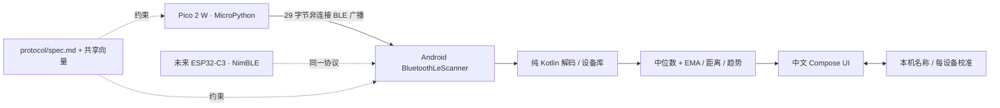

# Local BLE Finder V1

**手机直接安装：[下载最新测试 APK](https://github.com/JasonL111/PicoFinder/releases/download/dev-latest/local-ble-finder.apk) · [发布页与校验文件](https://github.com/JasonL111/PicoFinder/releases/tag/dev-latest)。无需 Android Studio 或自己编译。**

一个完全本地运行的 DIY BLE 标签查找器：**Pico 2 W + 官方 MicroPython** 持续广播，
**Android 12+ / Kotlin / Compose / Material 3** 按 RSSI 展示粗略距离与变化趋势。
没有 Wi-Fi 连接、云端账号、服务器、GPS、地图、配对或 Google Find Hub 接入。

> **RSSI 不是精确测距。** 人体、金属、墙壁、朝向和多径会改变读数；观察数秒趋势，
> 不要期待每一步距离都单调变化。本项目不提供方向、远程定位或防盗认证。



## 快速上手

硬件：Raspberry Pi **Pico 2 W**（不是 Pico / Pico W / Pico 2）、USB **数据线**、
Android 12 / API 31 以上且支持 BLE 的手机，以及一台用于刷写固件的电脑。
Pico 由 USB 持续供电；不需要电池、蜂鸣器或其他模块。

1. 按住 Pico 2 W 的 **BOOTSEL** 再接 USB，出现 `RP2350` 启动盘后松开。
2. 在[官方 Pico 2 W 下载页](https://micropython.org/download/RPI_PICO2_W/)选择
   **RPI_PICO2_W 官方稳定版 1.27.0** UF2（默认 ARM 构建）。此项目以该版本 API 和
   官方 RP2/BTstack 实现为基线；不要用其他 Pico 型号、preview 或 RISC-V 镜像替代。
3. 把 UF2 拖进启动盘，等待重启。用 Thonny 连接 MicroPython (Raspberry Pi Pico)，
   或安装 `python -m pip install mpremote==1.27.0`。
4. 参照 [Pico 部署说明](firmware/pico2w/README.md)上传四个 `.py` 文件到设备根目录。
   `main.py` 上电自动运行；默认 300 ms 广播、-59 dBm 参考、未知电量。
5. 在手机打开上方“下载最新测试 APK”，下载 `local-ble-finder.apk` 并安装。
   系统询问时，允许浏览器/文件管理器安装此来源的应用。APK 由 GitHub Actions 在测试、
   lint 和构建通过后自动发布；不需要你安装 Android Studio、JDK 或自行编译。
   这是 Debug 测试版；每次构建的签名可能不同，覆盖安装失败时需卸载旧版后重装，
   卸载会清除名称和校准，请先记录参数。完整流程见 [自动交付说明](docs/delivery.md)。
6. 手机开启蓝牙和系统位置开关，打开 App，**关闭“调试演示”**，点击“开始扫描”。
   授予“附近设备”和“精确位置”权限。未授权、蓝牙关闭或扫描失败均有中文说明。
7. 列表中选择与 USB 日志 `ID=XXXXXXXX` 相同的标签，进入查找。逐渐靠近 / 远离，
   看平滑 RSSI 和数秒趋势，距离仅供参考。默认 5 秒无包隐藏距离，10 秒判为失联。
8. 在“设备设置与 1 米校准”中命名标签；先保存编辑。把手机放在距标签约 1 米处，
   保持固定姿态、无金属或人体遮挡，开始扫描后点击“1 米校准”，等待 8 秒。
   有效样本至少 12 个且跨度至少 6 秒，波动过大不会覆盖原值。n 默认 2.2，可调 1..6。

下载 APK、固件和刷写工具需要联网，**App 和标签运行不需要互联网**。
Debug APK 只用于开发，勿用于正式签名发布；不要将本机签名密钥提交到 Git。

## 功能与运行规则

- 自定义 UUID + AD 0x21 Service Data；稳定随机 uint32 ID，支持多标签，不以 MAC/名称识别。
- 瞬时 / 平滑 RSSI、约 1 位小数距离、信号条、靠近 / 远离 / 稳定、最后接收时间。
- 中位数 + EMA、异常 RSSI 过滤、时间窗口趋势与滞后阈值、失联时隐藏陈旧距离。
- 名称、1 米 RSSI、n、失联阈值按 ID 保存在本机；无云备份、无 MAC 或历史轨迹存储。
- 仅用户主动前台扫描；转后台即停止，返回后手动重启。每次最多 2 分钟，至少间隔
  6 秒启动，错误不自动快速重试。被系统节流时按提示等待至少 30 秒。
- 调试版有明显“模拟模式”标识的 Fake Scanner；模拟库与真实库分离，不污染真实设备设置。
  第二个虚拟标签会周期性失联。Release 不编译 Fake Scanner。

## 权限选择

本功能从 BLE 推算相对物理距离，采取保守的 Android 权限方案，**不声明
`neverForLocation`**（该断言还可能过滤部分广播）。请求 `BLUETOOTH_SCAN`、
`ACCESS_FINE_LOCATION` 以及 Android 12 精确位置请求所需的 `ACCESS_COARSE_LOCATION`。
`BLUETOOTH_CONNECT` 只用于读取蓝牙开关状态和系统开启蓝牙提示；不建立 GATT 连接。
不请求 `INTERNET`、后台位置、通知或后台服务。详细依据见 [Android README](android/README.md)。

## 目录与开发

| 路径 | 内容 |
|---|---|
| [protocol/spec.md](protocol/spec.md) | 唯一线协议；29 字节封装、大小端、兼容规则 |
| [protocol/test-vectors.json](protocol/test-vectors.json) | 两端共享的有效 / 无效原始十六进制向量 |
| [firmware/pico2w](firmware/pico2w) | 可部署 MicroPython 固件与身份持久化 |
| [android/core](android/core) | 无 Android 依赖的协议、测距、校准、设备状态及测试 |
| [android/app](android/app) | 原生扫描、持久化、ViewModel、三个中文页面、Debug Fake |
| [tests/protocol](tests/protocol) | CPython 编码、配置、身份与模拟 BLE API 测试 |
| [.github/workflows/ci.yml](.github/workflows/ci.yml) | CI + CD：校验、构建、自动发布 APK 到 Releases |
| [docs/delivery.md](docs/delivery.md) | 无需本地编译的安装、发布渠道与下载说明 |
| [firmware/esp32c3/README.md](firmware/esp32c3/README.md) | ESP-IDF + NimBLE 迁移约束；无 ESP 固件 |

用户直接下载 APK；以下命令仅供开发者修改代码后验证。Android Studio 打开 `android/`，
包名 `local.ble.finder` 的修改方式及工具链见 [Android README](android/README.md)。

```bash
# 仓库根目录，无第三方 Python 测试依赖
python -m unittest discover -s tests/protocol -v
# Android 目录，Java 21 + SDK 36
./gradlew :core:test :app:testDebugUnitTest :app:assembleDebug :app:lintDebug
# 可选：已启动 API 31+ 模拟器 / 手机上的 Compose 模拟流程测试
./gradlew :app:connectedDebugAndroidTest
```

## 验证与边界

当前执行结果、APK 校验和、报告路径及人工验收清单见 [docs/testing.md](docs/testing.md)。
**代码构建 / 模拟测试与真实硬件端到端测试分开记录**；没有真实 Pico / 手机时，
不能证明射频广播、系统扫描过滤、接收率、实际距离校准或 USB 冷启动已工作。

协议含明文稳定 ID，无认证，可能被观察、伪造、重放，也有 32-bit ID 碰撞可能。
冲突时手动更改一个标签 ID。此 V1 适合本地 DIY，不是商用防盗或安全定位系统。

排错：[troubleshooting.md](docs/troubleshooting.md)；架构：[architecture.md](docs/architecture.md)。
未来 ESP32-C3 只需发送相同 UUID / 数据布局 / 版本 / 身份语义并通过共享向量，
无需更改 Android 核心解码、测距或 UI。

MIT License，见 [LICENSE](LICENSE)。
