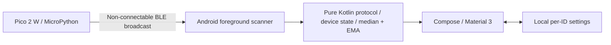

# PicoFinder

**English | [简体中文](README.zh-CN.md)**

[](https://github.com/JasonL111/PicoFinder/actions/workflows/ci.yml)
[](https://github.com/JasonL111/PicoFinder/releases)
[](LICENSE)

A local Bluetooth Low Energy item finder: a USB-powered Raspberry Pi Pico 2 W broadcasts a
tag ID, and an Android phone shows relative signal strength to help you search nearby.
Useful for finding keys or a bag around a home; it is not precise indoor positioning or a remote tracking network.

**Version 1.0.0 is prepared for its first signed release.** Publication requires the maintainer
signing Secrets and a `v1.0.0` tag. Until then, Actions provides Debug previews; the old
`dev-latest` entry is historical development output, not the formal 1.0.0 download.

## Download

- [Published releases](https://github.com/JasonL111/PicoFinder/releases) · [Latest stable release](https://github.com/JasonL111/PicoFinder/releases/latest)
- [v1.0.0 release page](https://github.com/JasonL111/PicoFinder/releases/tag/v1.0.0) — available after the signed tag workflow finishes.
- The formal asset is **`picofinder-1.0.0.apk`**, alongside `SHA256SUMS` and `build-info.json`.

Users do not need Android Studio or a local build. See [installation and delivery](docs/delivery.md).

## Features and interface

- Multiple tags with stable IDs, local names and per-tag settings.
- Raw and smoothed RSSI, an animated relative-signal ring, approximate distance and approach/away trends.
- Offline detection, last received time and an 8-second calibration at 1 metre.
- One brief vibration after a sustained very strong signal. Fixed entry **−45 dBm**, exit **−51 dBm**;
  users can disable vibration, but cannot edit these thresholds. Ordinary searching uses visual feedback.
- English and Simplified Chinese, selected by system language; light/dark themes and reduced-motion support.
- Foreground scans only, up to two minutes. No account, server, Internet connection, pairing or GATT service.

The find view puts signal strength and trend first, with distance/status below and expandable technical details.
Its ring uses existing smoothed measurements with a short display interpolation; animation does not alter
RSSI, distance, scanning or vibration decisions. See [UI design](docs/ui-v1.2.md).

## Requirements

| Component | Requirement |
|---|---|
| Tag | Raspberry Pi **Pico 2 W**, USB power and a USB data cable for initial setup |
| Firmware | Official **RPI_PICO2_W MicroPython 1.27.0**, stable ARM build |
| Phone | Android **12 / API 31+**, BLE support, Bluetooth and system Location enabled |
| Development only | JDK 21, Android SDK/target 36, the committed Gradle wrapper; CPython for tests |

Pico / Pico W / Pico 2 are different boards. The ESP32-C3 directory describes a future protocol-compatible
port; this repository does not currently provide tested ESP32-C3 firmware.

## Architecture and protocol



The v1 wire contract uses custom 128-bit Service Data, a stable uint32 Device ID, reference RSSI,
flags and battery information in a 29-byte advertisement. IDs do not depend on the Bluetooth MAC address.
[protocol/spec.md](protocol/spec.md) and the [shared test vectors](protocol/test-vectors.json) are authoritative.
The 1.0.0 work changes presentation and release packaging; UUID, wire format and firmware behavior remain compatible.

## Quick start

1. Hold **BOOTSEL** while connecting the Pico 2 W over USB. Release it when the `RP2350` drive appears.
2. Install official [RPI_PICO2_W MicroPython 1.27.0](https://micropython.org/download/RPI_PICO2_W/).
3. Follow [Pico setup](firmware/pico2w/README.md) to upload the four `.py` files to the device root.
   `main.py` runs at power-on. The default interval is 300 ms; reference RSSI is −59 dBm and battery is unknown.
4. Download and install the versioned Android APK. Allow your browser/file manager to install that source when prompted.
5. Enable Bluetooth and system Location, grant Nearby devices and precise location permissions, then tap **Start scan**.
6. Select the tag whose ID matches the USB log. Move slowly and observe several seconds of signal trend.

Existing PicoFinder tags do **not** need new firmware for 1.0.0. Firmware/tool downloads need Internet;
the app and tag do not need it during use. Debug previews include a clearly marked simulated mode with no real vibration;
formal Release APKs exclude the fake scanner.

## Calibration and nearby finding

In **Tag settings & 1 m calibration**, save any manual edits first. Hold the phone about 1 metre from the tag,
away from metal and body obstruction. Start scanning and keep both still for the 8-second calibration.
At least 12 valid samples spanning 6 seconds are required; unstable or insufficient samples leave the old value unchanged.
The path-loss factor defaults to 2.2 and accepts 1–6. Names, calibration, offline timeout and vibration preference stay on this phone.

Watch the ring and trend as you walk; use rough metres only as supporting information. A confirmed very strong signal
shows **“Very strong · Look nearby”** and may request one 120 ms vibration. Re-entry requires a sufficiently sustained
drop to −51 dBm or weaker, and alerts are at least 10 seconds apart. System touch feedback, Do Not Disturb and available
hardware can suppress vibration. Stop, offline, leaving the find view or moving into the background clears the active session.

## Versioned releases

`version.properties` is the common version source: **1.0.0 / versionCode 1000000**. A matching pushed tag
builds a maintainer-signed Release APK and creates **PicoFinder v1.0.0**. Branches, PRs and manual workflows run
tests/lint/builds and upload Debug artifacts only. Published assets and version tags are never overwritten.

Maintainer instructions, signing Secrets and the exact `v1.0.0` procedure are in [docs/releasing.md](docs/releasing.md).
Changes are recorded in [CHANGELOG.md](CHANGELOG.md).

## Development and testing

End users should install an APK. For source development, open `android/` in Android Studio or use the pinned wrapper:

```bash
python -m unittest discover -s tests/protocol -v
python -m unittest discover -s tests/ci -v
python -m unittest discover -s tests/localization -v
cd android
./gradlew :core:test :app:testDebugUnitTest :app:assembleDebug :app:lintDebug
# Optional with an API31+ emulator/device:
./gradlew :app:connectedDebugAndroidTest
```

Toolchain and source layout: [Android development](android/README.md). Actual software and hardware results,
including failures and pending checks, are separated in [docs/testing.md](docs/testing.md). Mock radio data and
rendered screenshots do not prove physical BLE, distance accuracy, vibration, frame rate or power use.

## Project structure

| Path | Purpose |
|---|---|
| `android/core` | Pure Kotlin decoding, filtering, distance, calibration and device state |
| `android/app` | Scanner, Compose UI, English/Chinese resources, local settings and haptics |
| `firmware/pico2w` | MicroPython firmware and deployment instructions |
| `protocol` | Wire contract and shared vectors |
| `tests` | Python protocol, localization and release regression tests |
| `.github` / `tools` | CI, verified artifact packaging and immutable version publication |
| `docs` | Delivery, releasing, design and validation records |

## Limits, privacy and scope

RSSI changes with bodies, walls, furniture, orientation and reflections. It cannot identify a room or direction,
and no signal does not prove the item is outdoors. This is not centimetre-level ranging, UWB, GPS, theft protection
or a Google Find Hub device. There are no maps, strongest-position records, indoor routes or background reminders.

The v1 advertisement exposes an unauthenticated stable ID: it can be observed, spoofed or replayed and 32-bit collisions
are possible. Local names/settings have no cloud backup. The user reported successful Pico/Android scanning, trends
at 0.5/1/3 m, unplug/offline detection and stable IDs after reboot; this does not validate every phone or environment.

## Roadmap, contributing and license

Future work includes wider phone validation, more measured indoor guidance and an ESP32-C3 port using the same protocol.
These are plans, not shipped capabilities. Contributions should preserve the wire contract and pass shared tests;
see [CONTRIBUTING.md](CONTRIBUTING.md).

MIT License — [LICENSE](LICENSE).
